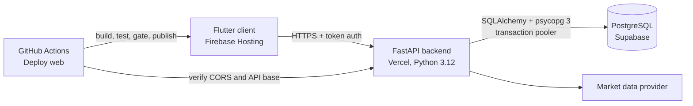

<h1 align="center">Hi 👋, I'm Aryaman Bhatnagar</h1>
<h3 align="center">AI/ML Engineer · Backend Developer · Data Science Graduate</h3>

---

## 🚀 About Me

I'm a **Computer Science (Data Science) graduate** who builds **production-ready AI systems and scalable Python backends**. I've shipped an LLM-powered chatbot and NLP systems that automated workflows for **500+ users**, and I care about the full lifecycle: data → model → API → client → deployment.

- 🤖 Currently learning **Generative AI, RAG pipelines and AI agents**
- 🛠️ Building with **FastAPI, Python, PostgreSQL, Docker and AWS**
- 🏆 Founded **Datavibe Network Club**: 100+ members, 10+ AI/ML events and hackathons
- 📫 Reach me: **aryamanb10@gmail.com**

---

## 📈 Featured Project: InvestEng

**An investment learning and portfolio analytics platform, built and shipped like a real product: tested API, client app, managed database, and an automated release pipeline.**

> ⚠️ Educational software, not investment advice. Orders are simulated paper trades.

<!-- CHECK: replace NEW_REPO_NAME with the exact repository name (one place, the link below) -->
[**Source code →**](https://github.com/AryamanBhatngar/NEW_REPO_NAME)

### What it does

InvestEng lets a user learn investing and analyze portfolios without risking real money. The quantitative engine behind it comes from [InvestEng Phase 1](https://github.com/AryamanBhatngar/InvestEng-phase1).

<!-- CHECK: keep only the lines below that ship in the new app -->
- **Demo mode and paper trading:** virtual cash (clearly labelled as virtual), simulated buy and sell orders, positions, P&L and transaction history
- **Market terminal:** US and Indian large caps, ETFs, indices and crypto, with watchlists and cached near-live quotes
- **Charts:** candlestick, line, volume and allocation views across several time ranges
- **Quantitative analytics:** returns, volatility, allocation, portfolio optimization (**Max Sharpe, Min Variance, Risk Parity, Black-Litterman**) and walk-forward backtesting
- **Resilient by design:** when a data provider fails, users get a clear error or data explicitly marked as delayed or offline, never silent bad data

### How it is built

| Layer | Technology |
|---|---|
| Backend | Python 3.12, FastAPI, REST APIs, modular services for market ingestion, feature engineering, optimization and analytics |
| Database | PostgreSQL on Supabase (via the transaction pooler for serverless), SQLite for local development, SQLAlchemy and psycopg 3 |
| Client | Flutter (Dart), production web build on Firebase Hosting |
| Hosting and CI/CD | Vercel (API), Firebase Hosting (web), GitHub Actions |
| Quality | pytest, `flutter analyze`, Flutter tests, workflow lint |

### Engineering decisions I'm proud of

- **Fail-fast configuration.** All settings come from environment variables. A missing or invalid setting raises an error that names the setting but never prints its value, so a misconfiguration is obvious and secrets stay out of logs.
- **Health endpoints that tell the truth.** `/live` checks the app itself, and `/ready` reports whether the database is actually reachable, so a broken deployment is caught by a probe, not by a user.
- **A release pipeline that refuses to ship a broken app.** The GitHub Actions workflow builds the web client, runs smoke checks, and refuses to publish while the API is failing. A final job then verifies CORS, the client URL and the API base against the real domain.
- **Serverless-friendly database access.** Production connects through Supabase's transaction pooler with TLS, which suits short-lived serverless functions.
- **Tested.** 131 backend tests, a clean Flutter static analysis, 44 Flutter tests and a clean workflow lint.
- **Secrets hygiene.** Credentials live only in environment variables and GitHub secrets, never in the repository, and keys are rotated when exposed.
- **Observable.** Structured JSON logging and correct proxy-header handling for running behind Vercel.

### Skills this project demonstrates

| Skill area | Evidence |
|---|---|
| Backend and API design | Modular FastAPI services, token auth, health endpoints |
| Data and quantitative analytics | Optimization methods, backtesting, market data pipelines |
| Databases | PostgreSQL in production, connection pooling, SQLAlchemy |
| Cloud and DevOps | Vercel, Firebase Hosting, GitHub Actions, environment-based config |
| Reliability and testing | Automated tests, deploy gates, readiness checks |
| Cross-platform development | Flutter client against a REST API |

---

## 🧩 More Projects

### 🤖 LLM Conversational AI Chatbot: *Production system @ Bhaifi Networks*

Production-grade conversational AI built with **RASA + Python**, automating onboarding for **500+ users** and cutting manual support workload by **40%**. Tuned NLP dialogue flows and intent classification across 20+ intents, improving response accuracy by 30%.
`RASA` `NLP` `Intent Classification` `Dialogue Flows` `Python`

### 📄 [AI-Powered Resume Analyzer](https://github.com/AryamanBhatngar/AI-Powered-Resume-Analyzer)

NLP screening system for automated resume parsing and ML-based candidate scoring across **30+ skill categories**, cutting manual screening time by **60%**. TF-IDF vectorization and classification models rank 100+ resumes against job requirements.
`Python` `NLP` `Scikit-learn` `spaCy` `TF-IDF` `Jupyter`

### 🏥 [CureX](https://github.com/AryamanBhatngar/cureX-application): Cross-Platform Healthcare Finder

**Android and iOS app** (Flutter + Firebase) with real-time data, AI query support and geolocation search across **50+ facility types**.
`Flutter` `Dart` `Firebase` `Geolocation`

### 📈 [InvestEng Phase 1](https://github.com/AryamanBhatngar/InvestEng-phase1)

The first version of the engine: FastAPI, SQLite and a browser single-page app, with paper trading, portfolio optimization and walk-forward backtesting, plus Docker and Render deployment files.
`Python` `FastAPI` `yfinance` `SQLite` `Docker`

### 🔊 Speech ↔ Text Converter

Real-time bidirectional speech-to-text and text-to-speech tool using applied NLP and audio signal processing.
`Python` `SpeechRecognition` `TTS` `NLP`

---

## 💻 Tech Stack

**Languages:** Python · SQL · C · C++ · Dart · HTML/CSS

**AI / ML / NLP:** Machine Learning · Deep Learning · NLP · LLMs · Generative AI · Text Classification · NER · Sentiment Analysis · Feature Engineering · Model Evaluation · scikit-learn · spaCy · Pandas · NumPy

**Backend and Frameworks:** FastAPI · REST APIs · SQLAlchemy · RASA · Streamlit · Flutter · GoLang

**Data and Databases:** PostgreSQL · MySQL · Firebase Realtime Database · ETL Pipelines · EDA · Statistical Analysis · A/B Testing

**DevOps and Tools:** Git · GitHub Actions · Docker · AWS · Google Cloud · Vercel · Supabase · Firebase Hosting · Jupyter · Google Colab · UiPath (RPA)

---

## 🧑‍💼 Experience Highlights

- **Software Engineering Intern @ Bhaifi Networks:** shipped 3 production features in a 4-month Agile cycle within a 10-engineer team
- **Technical Trainer @ GDGC ITM:** designed and delivered a week-long Flutter/Dart workshop for 300+ students
- **Founder and President, Datavibe Network Club:** organized DVN TechTrek '24 with 200+ participants across 5+ colleges

---

## 📊 GitHub Stats

---

⭐️ Always open to collaborating on AI/ML and backend projects. Say hello at <a href="mailto:aryamanb10@gmail.com">aryamanb10@gmail.com</a>.

