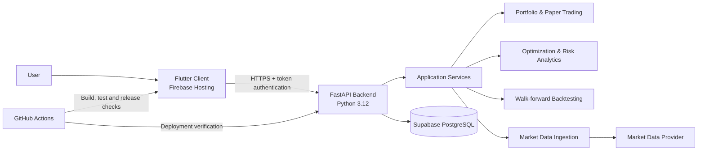
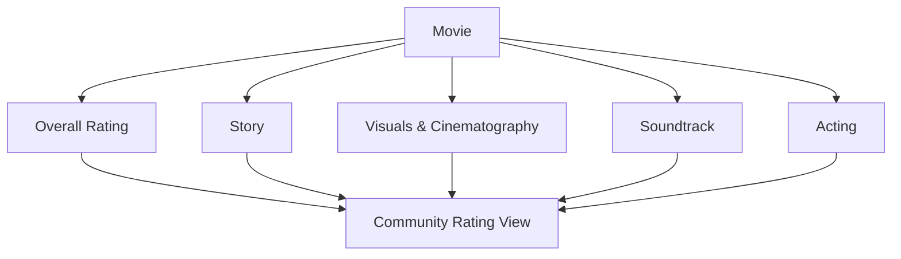
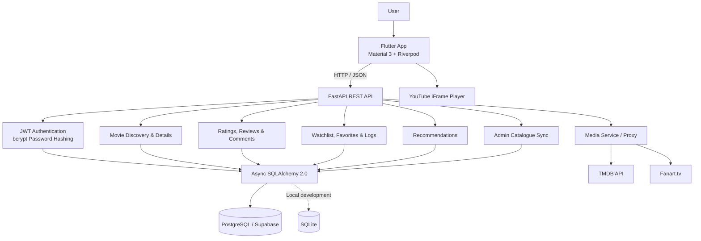
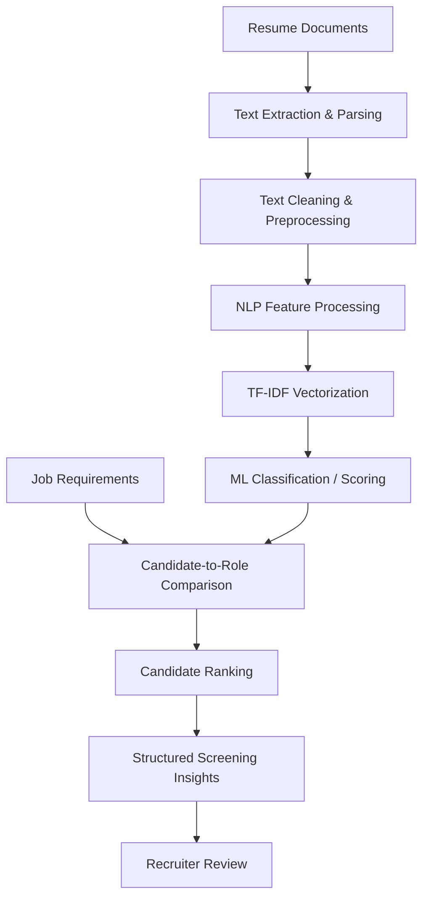
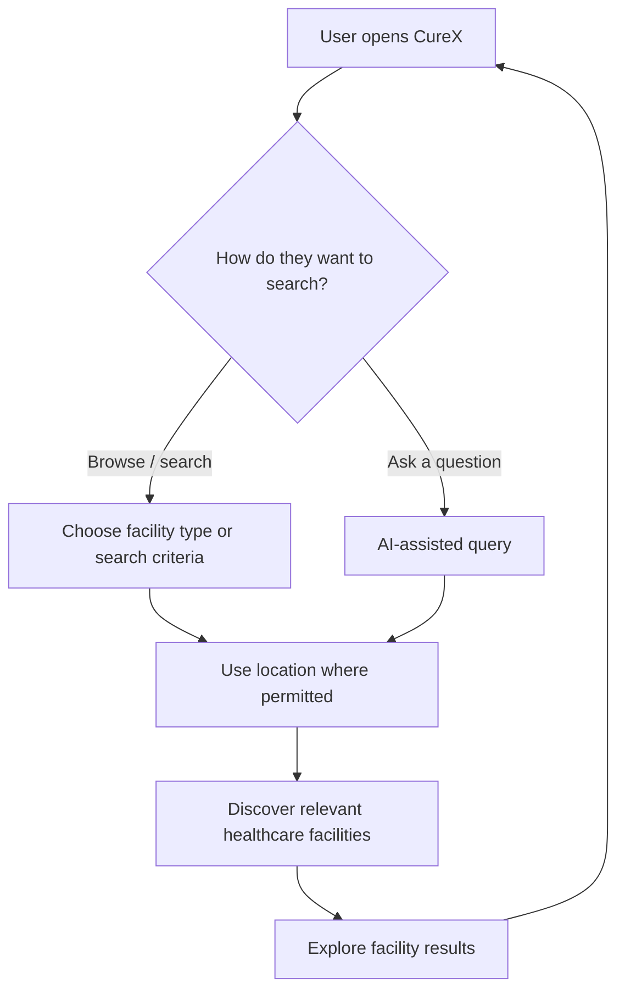

# Hi 👋, I'm Aryaman Bhatnagar

### AI/ML Engineer · Backend Developer · Data Science Graduate

**I build practical AI products, data-driven applications, and reliable backend systems.**

  
  
  
  

---

## 👨‍💻 About Me

I'm a **Computer Science graduate specializing in Data Science**, focused on building AI-powered products and dependable software systems. My work spans the full product lifecycle: understanding a problem, working with data, building the model or service, connecting it to an application, testing the system, and preparing it for deployment.

- 🤖 Exploring **Generative AI, LLM applications, RAG, NLP, and AI agents**.
- 🧠 Building with **Python, FastAPI, machine learning, data analytics, and PostgreSQL**.
- 📱 Developing cross-platform products with **Flutter and Firebase**.
- 🏗️ Interested in **AI engineering, backend architecture, product thinking, and applied research**.
- 🏆 Founded **DataVibe Network Club**, growing a 100+ member student community and organizing 10+ AI/ML events and hackathons.
- 📫 Reach me at **[aryamanb10@gmail.com](mailto:aryamanb10@gmail.com)**.

---

## 🚀 Featured Projects

The four projects below represent my primary work across **AI/ML, financial technology, media communities, and applied mobile products**.

| Project | Domain | Core focus |
|:---:|:---:|:---|
| **InvestEng** | FinTech / Quant | Portfolio analytics, optimization, and simulated investing |
| **CineLore** | Media / Community | Movie discovery, multi-axis ratings, and film tracking |
| **AI Resume Analyzer** | AI / NLP | Resume parsing, skill analysis, and candidate scoring |
| **CureX** | HealthTech / Mobile | Healthcare facility discovery, geolocation, and AI-assisted queries |

---

# 1. 📈 InvestEng — Investment & Portfolio Intelligence

### Learn investing. Understand risk. Explore portfolio strategies.

**InvestEng** is an investment-learning and portfolio-analytics platform designed to help users explore markets, understand portfolio risk, and experiment with quantitative strategies without placing real-money trades.

> **Important:** InvestEng's trading experience is simulated paper trading. It is educational software, not investment advice, and does not execute real-money trades.

### What it does

| Capability | Description |
|---|---|
| **Demo portfolio & paper trading** | Virtual cash, simulated buy/sell orders, positions, P&L, and transaction history. |
| **Market terminal** | Coverage for US and Indian large-cap stocks, ETFs, indices, and crypto, with watchlists and cached near-live quotes. |
| **Interactive charts** | Candlestick, line, volume, and portfolio-allocation views across multiple time ranges. |
| **Portfolio analytics** | Returns, volatility, allocation analysis, and risk-focused portfolio metrics. |
| **Portfolio optimization** | Implements Max Sharpe, Minimum Variance, Risk Parity, and Black-Litterman approaches. |
| **Strategy backtesting** | Walk-forward backtesting to evaluate how a strategy would have behaved across historical periods. |
| **Resilient market-data experience** | Provider failures are surfaced as clear errors or explicitly labelled delayed/offline data rather than being silently presented as live data. |

### System architecture

### Technology and engineering

| Layer | Implementation |
|---|---|
| **Backend** | Python 3.12, FastAPI, REST APIs, modular services for market ingestion, feature engineering, optimization, and analytics |
| **Quantitative layer** | Return and risk calculations, portfolio optimization, and historical strategy backtesting |
| **Database** | Supabase PostgreSQL using SQLAlchemy and `psycopg 3`; SQLite for local development |
| **Frontend** | Flutter / Dart, with the production web build hosted on Firebase Hosting |
| **API hosting** | Vercel |
| **CI/CD** | GitHub Actions for build, test, deployment gates, and post-deployment verification |
| **Quality checks** | pytest, `flutter analyze`, Flutter tests, and workflow lint |

### Engineering decisions

- **Fail-fast configuration:** settings are loaded from environment variables; invalid or missing configuration is reported without exposing secret values.
- **Meaningful health checks:** `/live` checks whether the application process is alive, while `/ready` checks whether the database is reachable.
- **Deployment gates:** the release workflow builds the client, runs checks, and blocks publication when required API checks fail.
- **Serverless-aware database access:** production database connectivity uses the Supabase transaction pooler with TLS.
- **Secrets hygiene:** credentials are supplied through environment variables and GitHub secrets rather than committed to source control.
- **Operational visibility:** structured JSON logs and proxy-header handling support deployment behind Vercel.

### Verification snapshot

| Check | Result reported for this project |
|---|---:|
| Backend tests | **131 passed** |
| Flutter tests | **44 passed** |
| Flutter static analysis | **Clean** |
| Workflow lint | **Clean** |

Test counts and quality-check status reflect the project snapshot described in this profile README; they should be updated whenever the test suite changes.

### Skills demonstrated

`Python` · `FastAPI` · `Flutter` · `PostgreSQL` · `SQLAlchemy` · `Quantitative Finance` · `Portfolio Optimization` · `Backtesting` · `REST API Design` · `CI/CD` · `Cloud Deployment` · `Automated Testing` · `Reliability Engineering`

**Repository:** Private project. Source-code access is restricted.

---

# 2. 🎬 CineLore — Movie Discovery & Community Platform

### Discover films. Rate every dimension. Keep your cinema life in one place.

**CineLore** is a responsive cinema discovery, rating, community discussion, and personal film-tracking application. It combines a locally seeded movie catalogue with optional official media integrations for richer movie information and artwork.

### Product experience

| Feature | Description |
|---|---|
| **Movie discovery** | Browse a seeded catalogue of 60+ films, with discovery and filtering capabilities exposed through the API. |
| **Detailed movie pages** | View movie information, artwork, cast and credits, certifications, video details, and related metadata when available. |
| **Cinematic media** | Explore posters, backdrops, scene stills, and embedded trailers. |
| **Five-axis ratings** | Rate each film overall and across Story, Visuals & Cinematography, Soundtrack, and Acting. |
| **Spoiler-aware reviews** | Publish reviews with spoiler flags to protect plot details. |
| **Community discussions** | Like reviews and participate in threaded comments with nested replies. |
| **Personal film vault** | Track watched films, favorites, dropped titles, and watchlist entries. |
| **Recommendations** | Retrieve personalized recommendations through the `for-you` endpoint and similar-title discovery. |
| **Catalogue administration** | Trigger catalogue synchronization through the administrator API. |

### Five-axis rating model

### Application architecture

### Technology stack

| Layer | Technologies |
|---|---|
| **Frontend** | Flutter, Riverpod, Material 3 |
| **UI packages** | `cached_network_image`, `carousel_slider_plus`, `flutter_rating_bar` |
| **Video** | `youtube_player_iframe` |
| **Backend** | Python, FastAPI, Pydantic v2, `httpx` |
| **Database access** | Async SQLAlchemy 2.0 |
| **Database** | Supabase PostgreSQL with local SQLite / `aiosqlite` fallback |
| **Authentication** | JWT and bcrypt password hashing |
| **Media integrations** | TMDB and Fanart.tv; YouTube for embedded video playback |

### Data model

- `users` — accounts, profiles, bios, and favorite-genre preferences.
- `movies` — local catalogue, artwork, trailer data, cast information, and rating aggregates.
- `user_movie_logs` — watched, watchlist, and dropped states; favorites, watch dates, and rewatch counts.
- `ratings` — overall half-star ratings and four category sub-scores.
- `reviews` — written reviews and spoiler flags.
- `review_comments` — top-level comments and nested replies.
- `review_likes` — review upvote tracking.

### Local-first catalogue and media enrichment

CineLore remains browseable without external media credentials. At startup, the backend creates or upgrades its relational tables and idempotently seeds the local catalogue. When configured, TMDB and Fanart.tv integrations enrich the catalogue with additional artwork, scene stills, cast information, credits, certifications, video details, and current scores.

### API surface

`/api/v1/auth/*` · `/api/v1/movies/discover` · `/api/v1/movies/{id}` · `/api/v1/movies/{id}/similar` · `/api/v1/movies/{id}/rate` · `/api/v1/movies/{id}/reviews` · `/api/v1/reviews/{id}/comments` · `/api/v1/users/{id}/dashboard` · `/api/v1/users/{id}/logs` · `/api/v1/recommendations/for-you` · `/api/v1/admin/sync-tmdb` · `/api/v1/media/proxy`

**Repository:** [CineLore source code](ADD_CINELORE_REPOSITORY_URL)

---

# 3. 📄 AI-Powered Resume Analyzer — NLP-Based Resume Screening

### Turn unstructured resumes into structured, comparable candidate insights.

The **AI-Powered Resume Analyzer** is an NLP-based screening system designed to extract information from resumes and evaluate candidate profiles against job requirements.

It combines resume parsing, text processing, TF-IDF feature extraction, and machine-learning-based scoring to help organize and prioritize candidate profiles.

### What it does

| Capability | Description |
|---|---|
| **Resume parsing** | Processes resume documents and extracts text for analysis. |
| **Text preprocessing** | Cleans and prepares extracted text for downstream NLP operations. |
| **Skill identification** | Evaluates candidate information across 30+ skill categories. |
| **TF-IDF representation** | Converts text into numerical features for machine-learning workflows. |
| **Candidate scoring** | Applies classification/scoring logic to compare resumes against job requirements. |
| **Candidate ranking** | Helps prioritize profiles for further human review. |

### Processing pipeline

### Technology stack

| Area | Tools / concepts |
|---|---|
| **Language** | Python |
| **NLP** | Text processing, skill extraction, resume parsing |
| **Feature engineering** | TF-IDF vectorization |
| **Machine learning** | Scikit-learn classification and scoring workflows |
| **NLP libraries** | spaCy |
| **Experimentation** | Jupyter Notebook |

### Reported project outcomes

- Evaluates resumes across **30+ skill categories**.
- Supports screening and ranking workflows for **100+ resumes**.
- Project-reported reduction of up to **60% in manual screening time**.

These are project-reported figures; actual screening outcomes depend on the quality of source resumes, role criteria, and human review.

### Skills demonstrated

`Python` · `NLP` · `TF-IDF` · `Scikit-learn` · `spaCy` · `Feature Engineering` · `Text Classification` · `Candidate Scoring` · `Data Processing`

**Repository:** [AI-Powered Resume Analyzer](https://github.com/AryamanBhatngar/AI-Powered-Resume-Analyzer)

---

# 4. 🏥 CureX — Cross-Platform Healthcare Finder

### Helping users discover nearby healthcare facilities through a mobile-first experience.

**CureX** is a cross-platform healthcare-facility discovery application built with Flutter and Firebase. It combines location-aware search with AI-assisted queries to help users explore healthcare facilities and services.

### Core capabilities

| Capability | Description |
|---|---|
| **Cross-platform mobile app** | Flutter-based Android and iOS application. |
| **Healthcare discovery** | Search and explore healthcare facilities across 50+ facility types. |
| **Geolocation** | Use location-aware discovery to help users find relevant nearby facilities. |
| **AI-assisted queries** | Provide an AI-supported way to ask healthcare-facility discovery questions. |
| **Firebase integration** | Firebase-backed application services and data integration. |

### User journey

### Technology stack

| Layer | Technologies |
|---|---|
| **Application** | Flutter |
| **Language** | Dart |
| **Backend services** | Firebase |
| **Location features** | Geolocation |
| **AI interaction** | AI-assisted query support |

### Skills demonstrated

`Flutter` · `Dart` · `Firebase` · `Geolocation` · `Cross-platform Development` · `Mobile UX` · `AI-assisted Search`

> CureX is a healthcare discovery application. It should not be presented as a diagnostic tool or a substitute for professional medical advice.

**Repository:** [CureX — Healthcare Finder](https://github.com/AryamanBhatngar/cureX-application)

---

## 🧠 Technical Skills

| Category | Technologies and concepts |
|---|---|
| **Languages** | Python, SQL, C, C++, Dart, HTML, CSS |
| **AI / ML / NLP** | Machine Learning, Deep Learning, NLP, LLMs, Generative AI, text classification, NER, sentiment analysis, feature engineering, model evaluation |
| **Data science** | Pandas, NumPy, scikit-learn, spaCy, EDA, statistical analysis, data visualization |
| **Backend** | FastAPI, REST APIs, SQLAlchemy, RASA, Streamlit |
| **Frontend / Mobile** | Flutter, Firebase, Material 3 |
| **Databases** | PostgreSQL, MySQL, SQLite, Firebase Realtime Database |
| **Cloud / DevOps** | Docker, GitHub Actions, AWS, Google Cloud, Vercel, Supabase, Firebase Hosting |
| **Tools** | Git, GitHub, Jupyter, Google Colab, UiPath (RPA) |

---

## 🧑‍💼 Experience & Leadership

- **Software Engineering Intern — BhaiFi Networks:** Contributed to production software features in an Agile engineering environment, working with a 10-engineer team.
- **Technical Trainer — GDGC, ITM:** Designed and delivered a week-long Flutter/Dart workshop for **300+ students**.
- **Founder & President — DataVibe Network Club:** Built a student technology community of **100+ members** and organized DVN TechTrek '24, with **200+ participants across 5+ colleges**.

---

## 📊 GitHub Activity

---

### Let's build something meaningful.

⭐ Always open to collaborating on **AI/ML, data science, backend engineering, and product-focused projects**.

**[Email](mailto:aryamanb10@gmail.com) · [LinkedIn](https://www.linkedin.com/in/aryaman-bhatnagar-abgwl20122003/) · [GitHub](https://github.com/AryamanBhatngar)**

'''

out = Path("/mnt/data/Aryaman_GitHub_Profile_README.md")
out.write_text(profile_readme, encoding="utf-8")
print(f"Created: {out} ({out.stat().st_size:,} bytes)")
